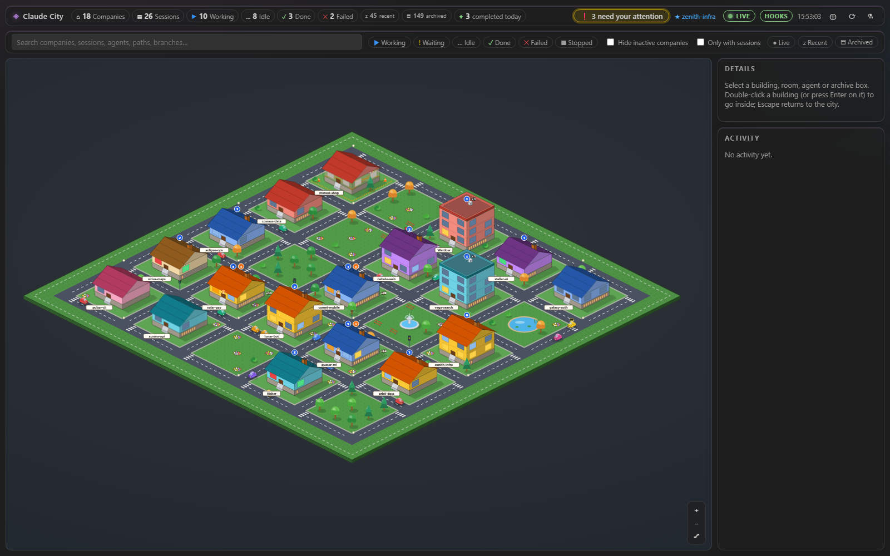
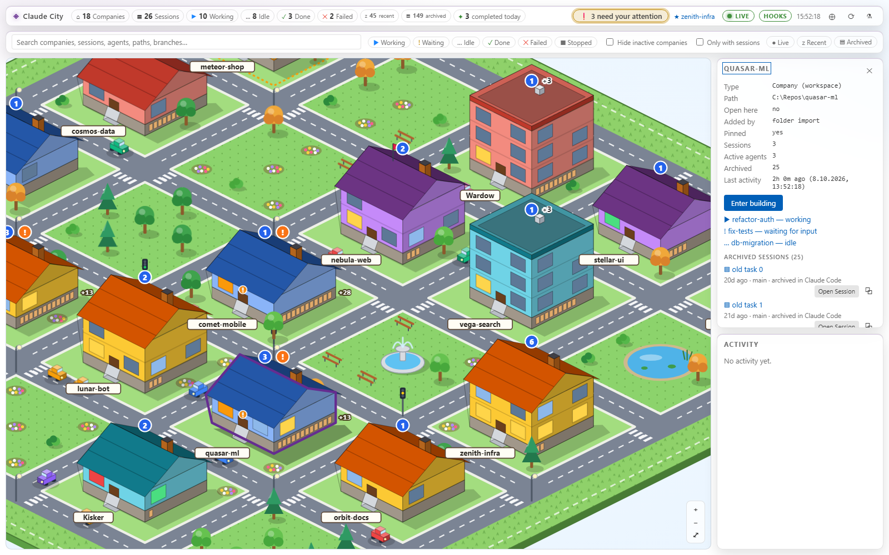
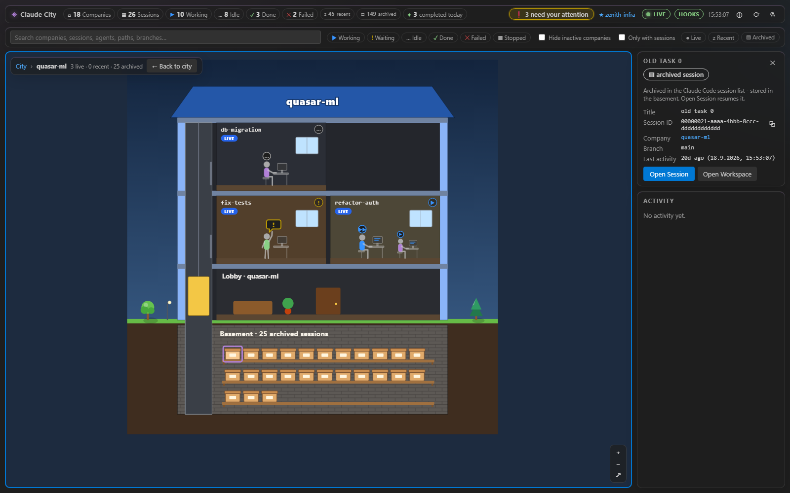
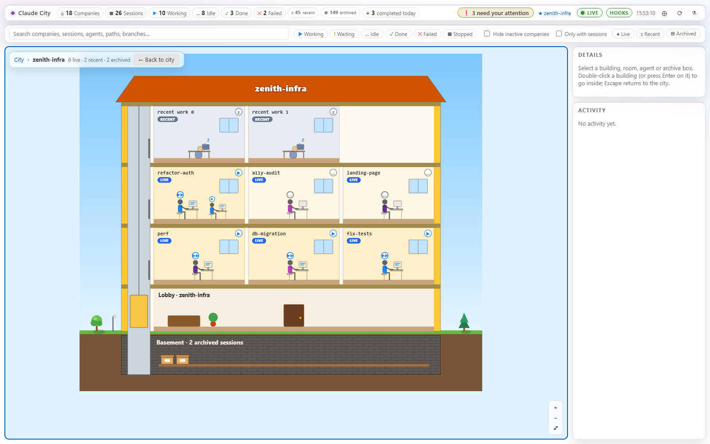

# Claude City

A living city visualization of your local **Claude Code** environment, inside VS Code.

| City metaphor | Claude Code concept |
| --- | --- |
| Toy house on the play-rug city map | Workspace / repository |
| Lit window on the facade (colour = phase) | Live or recent session (one window each) |
| Orange "!" over the door, badges on the roof | Sessions waiting for you / number of live sessions |
| Cardboard boxes in the basement strip ("+N") | Archived sessions - visible without clicking |
| Room inside the building (level 2) | Live session (characters at desks) or recent session (sleeping character, "z") |
| Character at a desk | Main agent of a session; subagents walk out of the elevator to their desk |
| Basement shelves with archive boxes (level 2) | Archived sessions (one box each, `Open Session` resumes them) |
| Construction site (fence, cones) | Imported folder not found on the last scan |
| Sparkle | A task was completed |
| Activity feed | Session changes (polling) + live hook events |

| City (dark) | City close-up (light) |
| --- | --- |
|  |  |
| **Building view with basement (dark)** | **Building view (light, reduced motion)** |
|  |  |

## Features

- **All workspaces, always visible**: every workspace Claude City knows (imported folders, open VS Code folders, cwds of live and past sessions, discovered projects) gets a building - with or without sessions, open or not, however old. Buildings without any session are calm and unlit (still clickable). See [Workspaces](#workspaces).
- **Import Workspaces from Folder…**: pick the folder that contains your projects; every project in it becomes a building, new projects appear automatically.
- **Activity bar overview**: counts, data source (LIVE / DEMO / errors), hook status, "needs your attention" shortcut and a one-click *Install live event hooks…* offer.
- **Status bar item** (e.g. `3 working · 1 waiting`), click to open the city.
- **City panel** (`Claude City: Open City`) with two levels
  - **Level 1 - the city ("play rug")**: a slightly 3D (isometric) toy town. Every workspace is a colourful house on its own plot (palette per workspace), connected by streets with zebra crossings; parks with trees, a pond, a fountain, benches, street lamps and traffic lights in between; toy cars drive around (click one: *Beep!*; the yellow **taxi** drives you to the next building that needs your attention). Every live / recent session is a lit window (working = warm yellow, waiting = pulsing orange + "!" over the door, idle = blue, recent = dim blue, done = green, failed = red), archived sessions are cardboard boxes in the basement strip ("+N" beyond 12). Houses with 1-2 floors get a pitched roof, bigger ones are office blocks (up to 6 floors). Hover lifts a house and shows its counts.
  - **Level 2 - inside a building**: double-click a house, press Enter on it or use *Enter building* in the details. A cut-away side view: lobby, office floors with one room per live session (characters at desks, raised hand when waiting, check mark when done, red warning when failed) and per recent session (sleeping character), an elevator subagents walk out of, and the **basement** with one archive box per archived session (up to 60, then "+N" which opens the full list). Breadcrumb *City › name*, *Back to city*, Escape or Backspace return to the city with the previous camera.
  - **zoom & pan** on both levels: mouse wheel zooms around the cursor, drag to pan, `+` / `−` / fit buttons, keyboard `+` `−` `0` and arrow keys when the map is focused. Zoomed far out, small decorations and labels are hidden (level of detail)
  - **keyboard**: Tab to a building, then arrow keys move to the neighbouring building on screen (and show its details), Enter goes inside, Space shows details, Escape closes details / goes back up a level; all rooms and archive boxes are focusable with descriptive labels
  - **search & filters**: by company / session / agent name, task or path; state chips (working, waiting, idle, done, failed, stopped); *hide inactive companies*; *only companies with sessions* (both off by default)
  - **scales to 100+ buildings**: rows adapt to the panel's shape, buildings with working/waiting sessions come first, then by last activity, then by name; the city zooms to fit on first load and after an import
  - **detail panels** for buildings (path, sessions, active agents, last activity, *Enter building*, *Open Workspace* / *Open in New Window*), archive boxes (title, session id, branch, last activity, *Open Session*), rooms (session id with copy button, state, status, waiting for, started, agents, *Open Session* / *Open Workspace*) and agents (type, parent session, state, task, latest event, *Open Session*)
  - **HUD**: counts, most active company, tasks completed today, "❗ N need your attention" (click focuses the room), LIVE pulse, data-source and hook badges
  - **live events** (optional hooks): subagents spawn at the building entrance and walk to a desk, walk out when finished; task completion sparkles; attention bubbles; transient rooms for brand-new sessions
  - an optional static day/night tint (dusk rug colours, glowing street lamps at night); dark themes use a darker, still colourful rug
  - UI state (selection, filters, level, camera per level) survives hiding/reopening the panel; toy cars pause while the panel or the city level is hidden
  - scales to 150+ workspaces: the ground is drawn once per layout, houses only re-render when their sessions change, zoom / pan never re-render React
- **Three session tiers**: **Live** (reported by `claude agents --json --all` - running, or finished but still listed), **Recent** (not running, still in Claude Code's normal session list: dim windows, rooms with a sleeping character) and **Archived** (boxes in the basement strip of each house and on the basement shelves inside, "+N" for the rest). Recent and archived sessions come from your local transcripts (`~/.claude/projects`); their detail panel shows title, session id, branch, start / last activity and subagent count, with *Open Session* (resume) and *Open Workspace*. The building panel lists all recent and archived sessions (up to 200 per building). *Live / Recent / Archived* chips filter by tier; search also matches past titles and branches. Past sessions never count as working/idle/done and never create feed events. See [Past sessions](#past-sessions).
- **Live data** from `claude agents --json --all` (polled, never overlapping, diff-based updates). Polling stays the authoritative source; hooks only enrich it.
- **Demo mode** for trying it out without the Claude CLI (always clearly labelled *DEMO*).
- Light, dark and high-contrast themes (high contrast: outlines, no textures); *reduce motion* (VS Code setting or OS preference: parked cars, no walking, no flicker, instant level switches); keyboard accessible with a throttled screen-reader live region; decorations are hidden from screen readers.

## Requirements

- VS Code 1.90+
- Claude Code CLI with `claude agents --json` support (tested with 2.1.289). Without it, the extension shows demo data (or "CLI unavailable" when demo mode is off).
- Optional: the Claude Code VS Code extension (`anthropic.claude-code`) for *Open Session*.

## Settings

| Setting | Default | Description |
| --- | --- | --- |
| `claudeCity.claudePath` | `""` | Absolute path to `claude`; empty = search `PATH` and common install locations. |
| `claudeCity.pollIntervalSeconds` | `5` | Poll interval while a City view is visible (min 2). Hidden: 15 s. CLI unavailable: 30 s back-off. Each poll starts `claude.exe` (~1.8 s CPU on Windows), hence 5 s. |
| `claudeCity.demoMode` | `auto` | `auto` = demo only if the CLI is unavailable, `on` = always demo, `off` = never. |
| `claudeCity.workspaceRoots` | `[]` | Folders that contain your projects (user settings only). Every direct subfolder is a building; rescanned on activation, on *Refresh* and every 120 s. Usually filled by *Import Workspaces from Folder…*. |
| `claudeCity.discoverHistoricalProjects` | `true` | Best effort: show every project from `~/.claude/projects` as a building, even without a session within `history.maxAgeDays`. |
| `claudeCity.history.importSessions` | `true` | Import past sessions from local transcripts into each building's archive. Off = no transcript is read and the cached metadata is dropped. |
| `claudeCity.history.maxAgeDays` | `90` | Only transcripts modified within this many days (min 1). |
| `claudeCity.history.maxSessionsPerWorkspace` | `12` | Archived sessions per building sent with full details (min 0, most recent first); the rest comes from the lightweight history index. All are counted on the house (basement boxes, "+N") and shown as boxes in the basement (up to 60 drawn, the rest listed in the building panel). |
| `claudeCity.history.recentDays` | `14` | **Fallback only** (Claude Code archive marker off or unreadable): non-running sessions active within this many days are *recent*, older ones *archived* (min 0; `0` = archive everything that is not running). With the marker available, exactly the sessions archived in Claude Code are archived - no extra age rule. |
| `claudeCity.history.maxRecentPerWorkspace` | `20` | Recent rooms per building (min 0, most recent first); the rest is counted ("+N recent") and listed in the building panel. |
| `claudeCity.history.useClaudeCodeArchive` | `true` | Best effort: use the Claude Code extension's own *archived* flag (see [Past sessions](#past-sessions)). |
| `claudeCity.hookBridge.enabled` | `true` | Run the loopback-only live-event server. Hooks themselves are only installed by command. |
| `claudeCity.hookBridge.port` | `47821` | Fixed loopback port (fixed so the hook URL in Claude settings stays valid across restarts). Changing it requires reinstalling the hooks. |
| `claudeCity.ambient.dayNight` | `true` | Static tint of the city by local time of day. |

## Commands

- `Claude City: Open City`
- `Claude City: Refresh`
- `Claude City: Toggle Demo Data` (runtime override; changing the `demoMode` setting resets it)
- `Claude City: Install Live Event Hooks…`
- `Claude City: Remove Live Event Hooks…`
- `Claude City: Import Workspaces from Folder…` (also in the sidebar, the City HUD and the empty city)
- `Claude City: Remove Workspace Root…`
- `Claude City: Remove Workspace from City…` (also *Remove from City* in a building's detail panel)

## Workspaces

**Always visible.** Every workspace in Claude City's registry is shown as a building, whether or not it has sessions, is open in VS Code or was seen recently. The registry keeps up to 1000 entries; when it is full only *unpinned, automatically added* workspaces without live or archived sessions are dropped (oldest first). Imported and pinned workspaces are never dropped. Older registry data is migrated automatically. The filters *Hide inactive companies* / *Only with sessions* are off by default (they were reset once when updating to this version).

**Import Workspaces from Folder…** opens a folder picker (multi-select). For each chosen folder:

- every **direct subfolder** becomes a pinned workspace - except hidden folders (name starts with `.`) and `node_modules`, `bin`, `obj`, `out`, `dist`, `.git`, `$RECYCLE.BIN`, `System Volume Information`;
- **single-project heuristic**: if the chosen folder itself looks like a project (contains `.git`, `.claude`, `app.json`, `package.json` or a `*.sln`) and none of its subfolders does, the folder itself is imported as one workspace;
- a drive root (e.g. `D:`), a network share root or your home folder is never imported as *one* workspace (it would swallow every session); importing their subfolders is fine, the home folder is never imported as a subfolder;
- at most 500 workspaces per folder (a warning tells you how many were skipped);
- a summary is shown, e.g. *12 workspaces imported, 3 already known*.

The chosen folders are stored in `claudeCity.workspaceRoots` (user settings). They are rescanned on activation, on *Refresh* and every 120 s: new subfolders appear automatically; subfolders that disappeared stay as greyed buildings marked **folder not found** (never deleted automatically). A root that no longer exists produces one warning and no error.

Sessions are grouped by the longest matching workspace path, so live and archived sessions inside an imported project land in its building. When a project is imported, automatically created buildings for its subfolders (e.g. a session started in `repo/src`) are merged into it.

**Remove from City** (detail panel button or command) asks for confirmation and removes the building only - the folder on disk is never touched. The path is remembered as excluded (in VS Code's global state), so root rescans, project discovery and archived sessions don't bring it back; a *live* Claude session in that folder or importing it again does. **Remove Workspace Root…** stops scanning a root and asks whether its imported workspaces should be removed too. *Pin* / *Unpin* (detail panel) protects automatically added workspaces from the registry cleanup.

## Live events (hooks)

Claude Code supports [`type: "http"` hooks](https://code.claude.com/docs/en/hooks) that POST each hook's JSON input
(`Content-Type: application/json`) to a URL. Claude City runs a tiny HTTP server on `127.0.0.1:<port>` and, **only when you run
*Install Live Event Hooks…***, appends entries like this to your Claude settings:

```json
{
  "hooks": {
    "SubagentStart": [
      { "hooks": [{ "type": "http", "url": "http://127.0.0.1:47821/claude-city/hook",
                    "headers": { "X-Claude-City-Token": "<random token>" }, "timeout": 3 }] }
    ]
  }
}
```

Installed events: `SessionEnd`, `SubagentStart`, `SubagentStop`, `TaskCreated`, `TaskCompleted`, `Stop`, `StopFailure`,
`Notification`, `TeammateIdle`.

Deliberately **not** installed:

- `SessionStart` - per the docs it only supports `command` and `mcp_tool` hooks, not `http`. New sessions show up via polling;
  a resumed session is recognized by its first hook event after `SessionEnd`. Entries written by older Claude City versions are
  removed on re-install/uninstall (the install state shows *outdated* until you re-install).
- `WorktreeCreate` - per the docs, configuring this hook *replaces* Claude's git worktree creation and the hook must return a path.
- `WorktreeRemove` - a successful response makes Claude treat a hook-created worktree as removed (no git fallback).
- `PreToolUse` / `PostToolUse` - would add an HTTP round trip to every tool call (the parser still understands them if you add them yourself).

**Where:** you choose via QuickPick - user settings `~/.claude/settings.json` (default, all sessions on this machine) or an open
workspace's `.claude/settings.local.json`. A modal dialog shows the exact file before anything is written. For a workspace file
inside a git repository, `/<path>/.claude/settings.local.json` is added to the repository's local `.git/info/exclude` (the common git
dir for linked worktrees) so the token is never committed; if that fails you get a warning.

**How the file is changed:**

- missing file → created; invalid JSON or unexpected structure → **aborted, file untouched**
- backup `settings.json.claude-city-backup-<timestamp>` before every write (never overwritten; only the newest 5 are kept); atomic
  write (temp file + rename, retried briefly on Windows sharing violations); 2-space JSON; file mode and a UTF-8 BOM are preserved
- a symlinked settings file is followed: the real target is updated (backup and temp file next to it), the link stays a link
- foreign hooks and all other keys are never modified or reordered - only Claude City's own entries are appended
- idempotent: installing again does nothing; after a port/token change the old Claude City entries are replaced
- *Remove Live Event Hooks…* removes only Claude City entries (identified by an `http` handler pointing to `127.0.0.1`/`localhost` + `/claude-city/hook`) and the empty arrays/objects that leaves behind

**Security notes**

- The server listens on `127.0.0.1` only, accepts only `POST /claude-city/hook` with `Content-Type: application/json`,
  a `Host` of `127.0.0.1`/`localhost` on its port (DNS-rebinding protection), no browser `Origin` header or web-initiated `Sec-Fetch-Site` (`cross-site`/`same-site`/`same-origin`),
  a valid token (constant-time compare), bodies ≤ 256 KB and ≤ 100 requests/s.
- It always answers `200 {}` (or an error status) and **never returns decision fields**, so it cannot block or steer Claude.
  If VS Code is closed, Claude's request simply fails (non-blocking per the docs).
- Token: 256-bit random, stored in VS Code SecretStorage (fallback: a file in the extension's global storage) and shared by all windows; if it changes, the server restarts with the new token and the hooks show as *outdated* until re-installed. Claude Code can only
  interpolate header env vars that exist in the Claude process environment, which Claude City cannot control for arbitrary
  terminals - so the token is written as a fixed header value into the chosen settings file. Anyone able to read that file could post
  fake events to your city; the token protects nothing else. Remove the hooks to revoke.
- Only a whitelist of fields is read (ids, agent type, task subject, notification type/message, tool name); tool inputs, prompts and
  transcripts are never read. Strings are sanitized and truncated; everything is rendered as plain text.

## Past sessions

Claude Code stores each session as `~/.claude/projects/<encoded-project>/<session-id>.jsonl`. This format is **not a stable API**, so
the import is strictly best effort and isolated (`src/backend/transcriptParser.ts` + `HistoricalSessions.ts`):

- **When**: after the first live poll (never during activation), on *Refresh* and every 120 s - never in the 5 s poll loop.
- **What is read**: only top-level `<session-id>.jsonl` files whose name is a valid session id and whose mtime is within
  `history.maxAgeDays`; at most the newest 2000 files, and of each file **only the first and last 64 KB** (8 files in parallel).
  Optional `<session-id>/subagents/*.jsonl` files are only counted, never read. At most 2000 sessions are imported.
- **What is extracted**: cwd, first/last timestamp, git branch and a title (priority: custom title → AI title → summary →
  first real prompt → last prompt; meta, command and tool messages are skipped). Titles are single-line, control characters
  removed, max. 80 chars, rendered as plain text. Nothing else from the transcript is kept, and titles are never logged
  (the output channel only shows counts and durations).
- **Cache**: results are cached per file (path + mtime + size) in memory and - so restarts are cheap - persisted in VS Code's
  global state (extracted metadata only, max. 2000 entries; cleared when the import is switched off).
- **Grouping**: the session cwd is mapped to a building with the same longest-prefix rule as live sessions (home folder and drive roots
  only match exactly). A live or hook-only session with the same id always replaces the recent / archived room (also finished
  sessions that `claude agents --json --all` still reports - they stay *live* with phase done / stopped / failed).
  Buildings below an imported folder are never created for past sessions or discovered projects (they are merged into the
  imported building, also when an older version created them).
- **Tiers**: if Claude Code's archive marker is available, a non-running session is *archived* exactly when it is archived in the
  Claude Code extension's session list (manually, or automatically after `claudeCode.archiveInactiveSessions` days, default 14);
  every other past session is *recent* - there is no additional age rule. Only when the marker is off or unavailable, the
  fallback applies: *recent* if the last activity is within `history.recentDays` (default 14, boundary inclusive), *archived* if older. The tiers are re-evaluated on every
  history rescan (120 s).
- **Claude Code archive marker (unstable, best effort)**: Claude Code keeps the ids of archived sessions in its extension
  global state (`hiddenSessionIds` of `anthropic.claude-code`), which VS Code stores in `<user data>/User/globalStorage/state.vscdb`
  (SQLite). Extensions cannot read each other's state through the API, so Claude City reads that file **read-only** with a tiny
  built-in SQLite reader (`src/backend/ClaudeArchiveMarker.ts`, file size capped at 64 MB, re-read only when it changed) and
  keeps **only the session ids**. This is an undocumented internal: if it cannot be read (other editor, remote window, changed
  format, setting off) the output channel says so and the `history.recentDays` age fallback applies.
- **Payload bounds**: per building at most `maxRecentPerWorkspace` recent and `maxSessionsPerWorkspace` archived rooms; additionally
  a lightweight index (id, title, last activity, branch, tier) of all archived sessions and of recent ones over the room limit,
  max. 200 per building and 2000 in total (newest kept).
- *Open Session* on a recent or archived room resumes it via the Claude Code extension (same URI handler as below).
- `claudeCity.discoverHistoricalProjects` (now default `true`) is kept for backward compatibility: it additionally shows projects whose
  sessions are all older than `maxAgeDays` as empty buildings.

## Open Session

*Open Session* uses the Claude Code extension's documented URI handler
[`vscode://anthropic.claude-code/open?session=<id>`](https://code.claude.com/docs/en/vs-code) (scheme follows your editor, e.g.
`vscode-insiders`). Session ids are validated (`[A-Za-z0-9_-]`) before the URI is built; workspace paths are only taken from the
internal registry. If the session belongs to a folder that is not open in this window, you are offered *Open Workspace* /
*Open in New Window* first. If the Claude Code extension is missing, you get a hint and can copy `claude --resume <id>` instead.

## Privacy & security

- Runs only the local `claude` CLI with fixed arguments; the only network listener is the loopback hook bridge described above; no telemetry.
- Webviews use a strict Content Security Policy (nonce scripts, no inline styles, no `unsafe-inline`, no remote resources). All graphics are inline SVG generated in code (no images or fonts). Walking, driving and level transitions use the Web Animations API (CSP-safe).
- Session names, paths, archived titles and hook texts are rendered as plain text.
- Folder import / root rescans only list folder names (async, one level deep plus a marker check); folder paths only come from the native folder picker or your user settings - the webview can only send workspace ids, never paths.
- Past-session import reads local transcripts read-only (head/tail only, see [Past sessions](#past-sessions)); no transcript content is logged or sent anywhere.

## Troubleshooting

- **"Claude CLI unavailable"**: install Claude Code, make sure `claude` is on `PATH`, or set `claudeCity.claudePath` to the absolute path (e.g. `C:\Users\<you>\.local\bin\claude.exe`). Use *Retry* / *Refresh* afterwards.
- **Hook badge shows `HOOKS ✕` / "port in use"**: another program - or another VS Code window running Claude City - owns the port. Only one window receives live events; the others retry every 30 s and keep polling. Change `claudeCity.hookBridge.port` and reinstall the hooks if another program uses it.
- **Hooks installed but no live events**: hooks are read when a Claude session starts - restart running sessions. Some hosts (e.g. remote / container / WSL sessions, or Claude running on another machine) cannot reach `127.0.0.1` of your VS Code machine; polling still works there. Check *Output → Claude City* for rejected requests (wrong token after reinstalling elsewhere → reinstall).
- **Badge shows `HOOKS ⚠`**: hooks were installed with an old port/token; run *Install Live Event Hooks…* again (it replaces the old entries).
- **Restore settings**: every write leaves `settings.json.claude-city-backup-<timestamp>` next to the file.

## Development

```bash
npm install
npm run compile          # typecheck (extension + webview) + esbuild bundles
npm test                 # vitest unit tests
npm run test:integration # VS Code smoke test (downloads VS Code)
npm run package          # builds agent-city.vsix
```

See [docs/RELEASING.md](docs/RELEASING.md) for the release checklist and [CHANGELOG.md](CHANGELOG.md) for changes.

Press `F5` in VS Code to launch an Extension Development Host. To try live events without touching your real settings, install the
hooks into the workspace's `.claude/settings.local.json` of a scratch folder and start `claude` there.

## License

MIT
